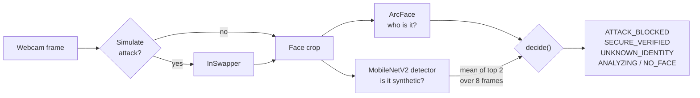

# Face-Swap Impersonation vs. Identity Verification

A deep-learning course project that tests how well face verification holds up against **live face-swap attacks**, and builds a swap detector that can veto an identity match.

| Question | Answer, measured on a held-out test set |
|---|---|
| Does ArcFace verification stop an InSwapper swap? | **No.** It accepts **99.6%** of swaps as the impersonated person. |
| Does adding a swap detector help? | **Yes**, against non-adaptive swaps: **96.2%** caught, **6.1%** of real frames flagged. |
| Does it survive an attacker who targets the detector? | **No.** A 1/255 perturbation drops detection to **0%**. |

The full picture, including the experiments that failed, is in [`docs/`](docs/index.md).

## How it works



The detector can block a match that ArcFace accepted, and a positive verification needs at least 3 frames of evidence. Blocking is immediate. Details: [Architecture](docs/architecture.md).

## Results

Held-out test set (identity-disjoint, 263 real + 263 fake crops), deployed detector:

| Threshold | Swaps caught | Real frames flagged |
|---|---|---|
| 0.8 | 90.5% | 1.1% |
| 0.5 | 94.7% | 4.2% |
| **0.3 (deployed)** | **96.2%** | **6.1%** |

What these numbers do **not** show:

- Robustness to an adaptive attacker. Detection under white-box PGD is 0%, and adversarial training made the model block 62–67% of real faces, so it was not deployed.
- Behaviour on swap tools other than InSwapper, or across many cameras and people.
- The rate at which a real user is blocked over a session.

See [Evaluation](docs/evaluation.md) and [Limitations](docs/limitations.md).

## Quick start

Needs Python 3.10, Node.js 18+, and (recommended) an NVIDIA GPU. Model weights other than the swap detector are not in git; see [Getting started](docs/getting-started.md).

```bash
pip install -r requirements.txt
pip install "DL_project/insightface-0.7.3-cp310-cp310-win_amd64.whl"   # Windows only

python make_demo_identity.py                # the "victim" identity the attack impersonates
python enroll_user.py YourName --webcam     # enroll yourself (6 snapshots)

uvicorn unified_api:app --host 127.0.0.1 --port 8001

# second terminal
cd FaceGuard-Digital-Forensic-System/frontend
npm install && npm start                    # http://localhost:3005
```

Open the **Unified Checkpoint** tab. Docker (GPU) instructions are in [Getting started](docs/getting-started.md#run-with-docker).

## Repository

| Path | Contents |
|---|---|
| `unified_api.py`, `swapdet.py` | API and the swap detector with its verdict logic |
| `gen_swap_data.py`, `train_swapdet.py`, `eval_*.py` | Dataset generation, training and evaluation |
| `models/` | Swap-detector checkpoints (only the deployed one is tracked) |
| `eval_results/` | Metrics, logs, figures |
| `DL_project/` | ArcFace pipeline, enrollment, earlier research phases |
| `FaceGuard-Digital-Forensic-System/` | Bundled earlier project and the React UI |
| `docs/` | Documentation |

## Documentation

[Getting started](docs/getting-started.md) · [Architecture](docs/architecture.md) · [Evaluation](docs/evaluation.md) · [Security](docs/security.md) · [Limitations](docs/limitations.md)

## Notes

- The API has no authentication and is meant for local use; both Docker ports bind to `127.0.0.1`.
- `FaceGuard-Digital-Forensic-System/` carries its own README and licence.
