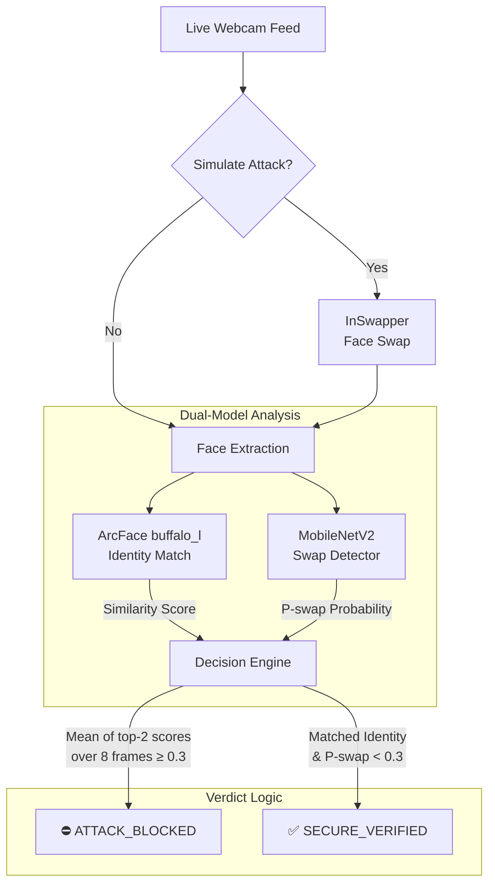

# Face-Swap Impersonation vs. Identity Verification

A face-verification system demonstrating real-time defense against live face-swap attacks (such as InSwapper).

**Summary:** Traditional identity matching systems are highly vulnerable to live face-swap impersonations. To address this, we developed a custom swap detector (MobileNetV2) that achieves **~96% detection accuracy** on identity-disjoint test data. Integrated into the live processing pipeline with temporal smoothing, the model successfully intercepts and vetoes fraudulent identity matches, providing an effective defense against real-time synthetic face presentations.

## System Architecture



The decision logic ensures that the swap detector can unilaterally veto an identity match. Temporal smoothing (evaluating the last 8 frames) prevents spurious single-frame artifacts from causing false blocks.

## System Capabilities

* **Real-Time Integration**: Intercepts InSwapper-based impersonations in a live video stream.
* **Authentication Pipeline**: Verifies enrolled users while providing a secondary check against spoofed identities.
* **Architecture**: Dockerized FastAPI backend and React frontend.

> 📚 **Detailed Documentation**: For a deep dive into the system design, check out the [Official Documentation in the `docs/` folder](docs/index.md), which includes architectural diagrams, security audits, and full evaluation metrics.

## Quick Start (Local Demo)

```bash
# 1. Install requirements
pip install -r requirements.txt
pip install "DL_project/insightface-0.7.3-cp310-cp310-win_amd64.whl"   # Windows only

# 2. Setup Identities
python make_demo_identity.py                       # exports victim identity "Alice"
python enroll_user.py YourName --webcam            # enroll YOU (6 snapshots)

# 3. Start Backend
uvicorn unified_api:app --host 127.0.0.1 --port 8001

# 4. Start Frontend (New Terminal)
cd FaceGuard-Digital-Forensic-System/frontend
npm install
npm start
```

*Navigate to the **Unified Checkpoint** tab in the browser to initiate the real-time secure verification.*
